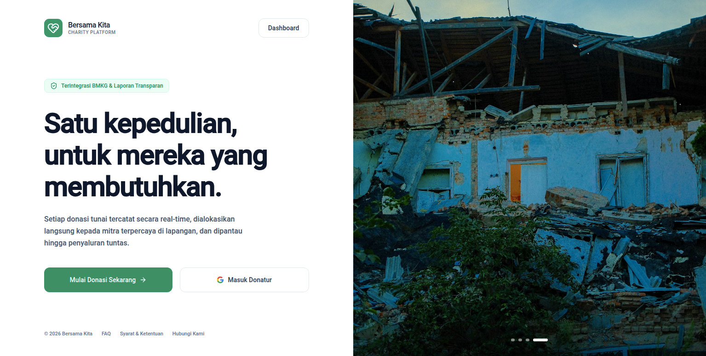
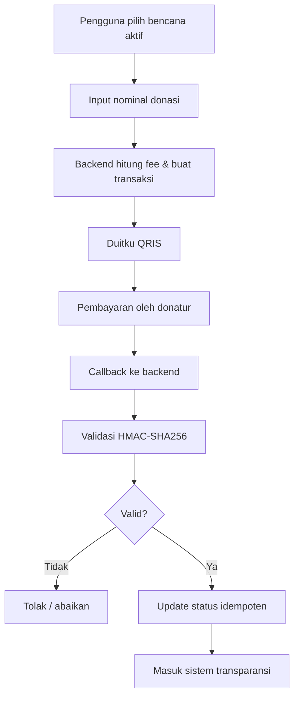
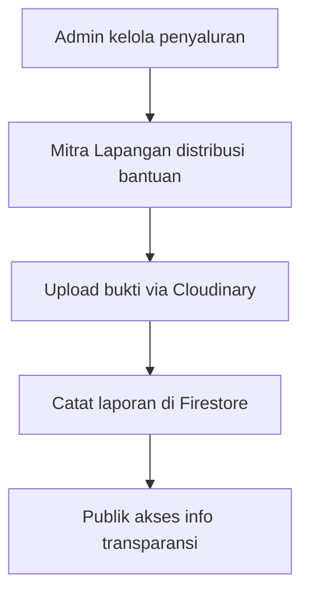
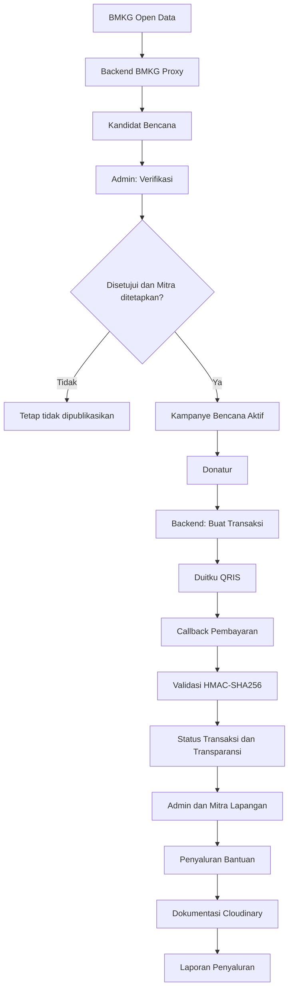

# Bersama Kita

### Satu Kepedulian, Sejuta Harapan

**Platform crowdfunding bencana alam untuk Indonesia** yang menghubungkan informasi gempa dari BMKG, proses verifikasi manusia, penggalangan dana melalui QRIS, penugasan Mitra Lapangan, dan pelaporan penyaluran bantuan secara transparan.

[](#status-proyek)
[](#teknologi-yang-digunakan)
[](#teknologi-yang-digunakan)
[](#lisensi-dan-penghargaan)

> **Bersama Kita bukan hanya tentang mengumpulkan donasi. Kami membangun alur bantuan yang mengutamakan verifikasi, akuntabilitas, dan keterbukaan informasi.**

---

## Daftar Isi

- [Tentang Bersama Kita](#tentang-bersama-kita)
- [Permasalahan yang Diangkat](#permasalahan-yang-diangkat)
- [Solusi yang Ditawarkan](#solusi-yang-ditawarkan)
- [Keunggulan dan Inovasi](#keunggulan-dan-inovasi)
- [Demo dan Tampilan Aplikasi](#demo-dan-tampilan-aplikasi)
- [Fitur Utama](#fitur-utama)
- [Alur Sistem](#alur-sistem)
- [Arsitektur Sistem](#arsitektur-sistem)
- [Teknologi yang Digunakan](#teknologi-yang-digunakan)
- [Struktur Proyek](#struktur-proyek)
- [Instalasi dan Pengembangan Lokal](#instalasi-dan-pengembangan-lokal)
- [Variabel Lingkungan](#variabel-lingkungan-env)
- [Deployment ke Vercel](#deployment-ke-vercel)
- [Keamanan dan Aturan Bisnis](#keamanan-dan-aturan-bisnis)
- [Pengujian dan Quality Assurance](#pengujian-dan-quality-assurance)
- [Dokumentasi Detail](#dokumentasi-detail)
- [Dampak Sosial](#dampak-sosial)
- [Roadmap Pengembangan](#roadmap-pengembangan)
- [Status Proyek](#status-proyek)
- [Tim Pengembang](#tim-pengembang)
- [Deklarasi Penggunaan AI](#deklarasi-penggunaan-ai)
- [Layanan Pihak Ketiga](#layanan-pihak-ketiga)
- [Lisensi dan Penghargaan](#lisensi-dan-penghargaan)

---

## Tentang Bersama Kita

Bersama Kita adalah platform crowdfunding yang dirancang untuk mendukung penggalangan dan penyaluran bantuan pada situasi bencana di Indonesia. Platform ini menghubungkan informasi awal bencana, verifikasi oleh Admin, dukungan donatur, pelaksanaan bantuan oleh Mitra Lapangan, dan dokumentasi penyaluran.

Fokus utama pengembangan Bersama Kita adalah membangun proses yang dapat ditelusuri: informasi bencana tidak langsung menjadi kampanye publik, transaksi donasi diproses melalui backend, dan aktivitas penyaluran dicatat agar dapat dipantau.

### Visi

Mendorong ekosistem bantuan bencana yang lebih terhubung, bertanggung jawab, dan transparan melalui pemanfaatan teknologi.

### Misi

- Mempermudah masyarakat menemukan kampanye bantuan bencana yang telah diverifikasi.
- Menghadirkan alur donasi digital melalui QRIS.
- Menghubungkan pengelola platform dengan Mitra Lapangan untuk pelaksanaan bantuan.
- Menyediakan informasi transaksi dan dokumentasi penyaluran yang dapat diakses publik sesuai aturan sistem.

## Permasalahan yang Diangkat

Dalam situasi bencana, masyarakat membutuhkan informasi yang jelas untuk menentukan bantuan yang akan diberikan. Penggalangan dana juga membutuhkan proses verifikasi, pengelolaan transaksi, koordinasi pelaksana lapangan, dan dokumentasi penyaluran yang dapat dipertanggungjawabkan.

Bersama Kita mengangkat kebutuhan tersebut sebagai satu alur layanan digital. Platform ini dirancang untuk mengurangi ketergantungan pada proses informasi dan pelaporan yang terpisah-pisah dengan menghubungkan tahapan penting dalam satu sistem.

## Solusi yang Ditawarkan

Bersama Kita mengintegrasikan lima tahapan utama:

1. **Sumber informasi:** data gempa diperoleh dari BMKG sebagai referensi awal.
2. **Verifikasi:** Admin memeriksa informasi, menetapkan Mitra Lapangan, lalu menyetujui publikasi secara eksplisit.
3. **Penggalangan dana:** masyarakat dapat berdonasi pada kampanye bencana aktif melalui QRIS.
4. **Pelaksanaan bantuan:** Mitra Lapangan menjalankan distribusi bantuan sesuai penugasan dan koordinasi.
5. **Transparansi:** transaksi dan laporan penyaluran dicatat agar informasi dana masuk dan pelaksanaan bantuan dapat ditelusuri.

## Keunggulan dan Inovasi

| Area | Pendekatan Bersama Kita |
|---|---|
| Validasi informasi | Data BMKG menjadi referensi, bukan publikasi otomatis. |
| Kendali publikasi | Admin harus menyetujui bencana dan menetapkan Mitra Lapangan sebelum publikasi. |
| Pembayaran digital | Integrasi Duitku Direct API untuk pembayaran QRIS. |
| Integritas transaksi | Callback diverifikasi menggunakan HMAC-SHA256 dan pembaruan status dirancang idempoten. |
| Pelaksanaan lapangan | Mitra Lapangan dikelola dan ditugaskan melalui sistem. |
| Akuntabilitas | Riwayat transaksi, laporan penyaluran, dokumentasi foto, dan audit log mendukung keterlacakan. |

**Prinsip inti:** tidak ada auto-approve, auto-publish, atau placeholder bencana yang belum diverifikasi. Setiap bencana hanya dapat dipublikasikan setelah Admin memberikan persetujuan eksplisit dan menetapkan Mitra Lapangan. Detail aturan terdapat pada `docs/DISASTER.md`.

## Demo dan Tampilan Aplikasi

> **Demo aplikasi:** https://bersamakita.vercel.app/
>
> **Repository:** https://github.com/Kanaka-Project/BersamaKita

Tangkapan layar aplikasi tersedia pada folder `screenshots/`. Berikut contoh tampilan yang sudah tersedia:




Screenshot tambahan (dashboard Mitra Lapangan, transparansi penyaluran) dapat ditambahkan pada folder `screenshots/` sesuai kebutuhan.

## Fitur Utama

| Fitur | Deskripsi |
|---|---|
| Manajemen Bencana | Integrasi data gempa BMKG dengan verifikasi manual Admin. |
| Persetujuan Manual | Bencana hanya dipublikasikan setelah Admin melakukan **APPROVE** dan menetapkan Mitra Lapangan. |
| Donasi QRIS | Pembayaran donasi menggunakan Duitku Direct API. |
| Transaksi Transparan | Riwayat dana masuk dan agregasi donasi berdasarkan bencana. |
| Manajemen Mitra | Pengelolaan akun dan penugasan Mitra Lapangan oleh Admin. |
| Penyaluran Dana | Pencatatan distribusi, pencairan, dan laporan penyaluran dana. |
| Dokumentasi Bukti | Dokumentasi penyaluran berupa foto melalui Cloudinary. |
| Peta Indonesia | Peta SVG interaktif untuk visualisasi katalog bencana dan posko. |
| Audit Log | Pencatatan aktivitas operasional untuk mendukung akuntabilitas. |

## Alur Sistem

### 1. Verifikasi Bencana

1. Sistem mengambil data gempa dari BMKG.
2. Data masuk sebagai kandidat bencana.
3. Admin melakukan pemeriksaan dan verifikasi.
4. Admin menetapkan Mitra Lapangan.
5. Admin memberikan persetujuan eksplisit.
6. Bencana berubah menjadi `admin_approved` dan dapat dipublikasikan.

**Status utama:** `pending_verification` → `admin_approved`

Tidak diperbolehkan:

- Auto-approve.
- Auto-publish.
- Publikasi tanpa persetujuan Admin.
- Publikasi tanpa penetapan Mitra Lapangan.
- Menampilkan placeholder bencana yang belum diverifikasi.

Detail: `docs/DISASTER.md`.

### 2. Alur Donasi

1. Pengguna memilih bencana aktif.
2. Pengguna memasukkan nominal donasi.
3. Sistem menghitung biaya administrasi.
4. Backend membuat transaksi melalui Duitku Direct API.
5. Pengguna membayar melalui QRIS.
6. Duitku mengirimkan callback ke backend.
7. Backend memvalidasi signature **HMAC-SHA256**.
8. Status pembayaran diperbarui secara idempoten.
9. Transaksi masuk ke sistem transparansi.



**Biaya administrasi platform:** 0,17% (perhitungan terpusat di `src/lib/fees.ts`).

### 3. Penyaluran Dana

1. Admin mengelola proses penyaluran.
2. Mitra Lapangan melaksanakan distribusi bantuan.
3. Bukti penyaluran diunggah melalui Cloudinary.
4. Laporan penyaluran dicatat dalam Firestore.
5. Informasi penyaluran dapat diakses publik sesuai aturan transparansi.



## Arsitektur Sistem

### Gambaran Alur Tingkat Tinggi



Diagram ini menggambarkan alur konseptual berdasarkan dokumentasi proyek. Detail implementasi endpoint dan penyimpanan dijelaskan pada dokumen teknis di folder `docs/`.

### Struktur Frontend

```text
src/
├── components/            # Komponen UI bersama (layout, feedback, landing)
├── config/                # Konfigurasi Firebase client & admin
├── features/              # Modul fitur per domain
│   ├── auth/              # Login pengguna, konteks auth & role
│   ├── admin/             # Portal & otentikasi Admin
│   ├── partner/           # Auth & dashboard Mitra Lapangan
│   ├── disaster/          # Katalog BMKG, peta, verifikasi, analisis situasi
│   ├── donation/          # Donasi, checkout QRIS, status, riwayat
│   ├── distribution/      # Laporan penyaluran & transparansi
│   ├── finance/           # Admin transaksi, pencairan, setelan Duitku
│   ├── operations/        # Audit logs
│   └── public/            # Halaman statis (FAQ, kontak, kebijakan)
├── lib/                   # Utilitas bersama (fees, firestore-errors, utils)
├── services/              # Integrasi eksternal
│   ├── firebase/          # auth, firestore, seed
│   ├── bmkg.ts            # Proxy BMKG
│   ├── duitku.ts          # Layanan pembayaran Duitku
│   └── cloudinary.ts      # Upload signature + validasi gambar
├── types/                 # TypeScript types (sinkron dengan Firestore)
├── App.tsx                # Routing utama
└── main.tsx
```

### Struktur Backend

```text
server/
├── app.ts                 # Entry point Express + mount routes
├── routes/
│   ├── bmkg.ts            # Proxy BMKG (autogempa, gempaterkini)
│   ├── payments.ts        # create, callback, check-status, simulate-paid, expire-sweep
│   ├── transparency.ts    # GET /summary
│   ├── admin.ts           # create-partner, reset-transactions
│   └── images.ts          # POST /sign (Cloudinary signed upload)
└── api/index.ts           # Vercel serverless entry (export `app`)
```

## Teknologi yang Digunakan

| Layer | Teknologi |
|---|---|
| Frontend | React 19, Vite 8, TypeScript, TailwindCSS v4, React Router 7 |
| Backend | Node.js 22, Express (modular: `server/app.ts` + `server/routes/`) |
| Autentikasi & Database | Firebase Auth (klien), Firestore, Firebase Admin SDK (server) |
| Pembayaran | Duitku Direct API -- QRIS (`SP`) |
| Data Bencana | BMKG Open Data |
| Penyimpanan Gambar | Cloudinary |
| Deployment | Vercel (fungsi serverless `api/index.ts` + static `dist/`) |
| Version Control | Git & GitHub |

## Instalasi dan Pengembangan Lokal

### Prasyarat

- Node.js 22.x
- npm
- Proyek Firebase
- Akun Duitku
- Akun Cloudinary

### Instalasi

```bash
git clone <REPOSITORY_URL>
cd bersama-kita

cp .env.example .env
# Isi nilai environment sesuai konfigurasi lokal.

npm install
npm run dev
# Express + Vite middleware → http://localhost:3005
```

### Skrip yang Tersedia

- `npm run dev` -- menjalankan Express + Vite middleware untuk pengembangan lokal.
- `npm run build` -- membangun frontend ke folder `dist/`.
- `npm run start` -- menjalankan server produksi lokal (`NODE_ENV=production tsx server/app.ts`).
- `npm run lint` -- melakukan pemeriksaan tipe (`tsc --noEmit`).

### Akun Staf (Development / Demo)

> ⚠️ **Peringatan Keamanan:** Kredensial di bawah ini hanya untuk lingkungan development/demo. Jangan gunakan password ini di produksi — rotasi segera sebelum deploy publik.

| Peran | Email | Password |
|---|---|---|
| Admin (Dashboard) | `bersamakita.my.id@protonmail.com` | `bersamakita01` |
| Partner (Mitra Lapangan) | `tanggaplombok@my.id` | `tanggaplombok@my.id` |

Akun di atas dibuat melalui Firebase Authentication (email/password). Pastikan dokumen `users/{uid}` memiliki `role` yang sesuai (`admin` / `partner`) agar akses dashboard berfungsi.

## Variabel Lingkungan (.env)

| Variabel | Prefix / Lokasi | Kegunaan |
|---|---|---|
| `VITE_FIREBASE_*` | Frontend | Konfigurasi Firebase JS SDK. |
| `VITE_APP_URL` | Frontend | Base URL (dev: `http://localhost:3005`). |
| `PORT`, `APP_URL` | Backend | Port dan base URL untuk callback/return Duitku. |
| `DUITKU_MERCHANT_CODE`, `DUITKU_API_KEY` | Backend | Kredensial Duitku -- **jangan pernah diekspos ke frontend**. |
| `DUITKU_ENVIRONMENT` | Backend | `sandbox` (default) atau `production`. |
| `ADMIN_SECRET_KEY` | Backend | Guard `POST /api/admin/reset-transactions`. |
| `CRON_SECRET` | Backend | Guard `GET /api/payments/duitku/expire-sweep` (Vercel Cron). |
| `FIREBASE_SERVICE_ACCOUNT_JSON` | Backend | Service account Firestore (Admin SDK), JSON satu baris. |
| `CLOUDINARY_CLOUD_NAME`, `CLOUDINARY_API_KEY`, `CLOUDINARY_API_SECRET` | Backend | Tanda tangan upload Cloudinary. |
| `ADMIN_EMAILS`, `PARTNER_EMAILS` | Backend | Allow-list staf transisional (comma-separated). |
| `VITE_ADMIN_EMAILS`, `VITE_PARTNER_EMAILS` | Frontend | Allow-list staf transisional (comma-separated). |

**Aturan keamanan:** variabel backend tidak menggunakan prefix `VITE_` agar tidak ikut terekspos ke bundle React. Jangan pernah melakukan commit terhadap file `.env`, private key, service account, API key, atau secret lainnya.

## Deployment ke Vercel

- File `vercel.json` mengatur framework `vite`, output `dist/`, rewrite `/api/:path*` ke fungsi serverless, serta cron `GET /api/payments/duitku/expire-sweep` setiap hari pukul 17:00 UTC.
- Jalankan build dan deployment:

```bash
npm run build
npx vercel deploy --prod
```

Pastikan seluruh variabel lingkungan telah dikonfigurasi pada proyek Vercel, termasuk `CRON_SECRET`.

## Keamanan dan Aturan Bisnis

| Aspek | Aturan Wajib |
|---|---|
| Autentikasi & Otorisasi | Firebase Authentication menangani login. Semua operasi sensitif memvalidasi ID token Firebase. Endpoint khusus Admin harus memeriksa peran Admin. Mitra hanya dapat dibuat oleh Admin. |
| Keamanan Pembayaran | Kredensial Duitku tetap di sisi server. Callback harus memvalidasi signature HMAC-SHA256. Proses pembayaran harus idempoten. Status pembayaran di client tidak dianggap final. |
| Keamanan Database | Aturan keamanan Firestore harus tetap ketat. Transparansi publik hanya melalui endpoint backend yang sudah diotorisasi. Jangan melemahkan aturan hanya untuk mengatasi error frontend. |
| Verifikasi Bencana | Data BMKG hanya sebagai referensi, bukan publikasi otomatis. Persetujuan Admin dan penetapan Mitra Lapangan wajib. |

## Pengujian dan Quality Assurance

Checklist pengujian yang direkomendasikan:

- [ ] Build produksi berhasil (`npm run build`).
- [ ] Pemeriksaan tipe berhasil (`npm run lint`).
- [ ] Pengguna tanpa autentikasi tidak dapat mengakses endpoint terlindungi.
- [ ] Pengguna non-Admin tidak dapat menjalankan endpoint khusus Admin.
- [ ] Bencana berstatus kandidat tidak tampil sebagai kampanye publik.
- [ ] Bencana tidak dapat dipublikasikan tanpa persetujuan Admin dan penetapan Mitra.
- [ ] Callback pembayaran dengan signature tidak valid ditolak.
- [ ] Callback pembayaran yang sama berulang kali tidak menggandakan transaksi.
- [ ] Status pembayaran ditentukan oleh hasil verifikasi backend, bukan klaim dari browser.
- [ ] Bukti penyaluran dapat diunggah dan ditampilkan sesuai izin akses.
- [ ] Data transparansi sesuai dengan transaksi dan catatan penyaluran.

> Tandai checklist hanya setelah pengujian dilakukan dan hasilnya tercatat. Jangan menyatakan sistem telah lolos pengujian keamanan atau siap produksi tanpa bukti.

## Dokumentasi Detail

Dokumentasi teknis lengkap berada di folder `docs/`:

| Dokumen | Isi |
|---|---|
| `ARCHITECTURE.md` | Arsitektur sistem dan diagram alur. |
| `API.md` | Spesifikasi endpoint backend. |
| `AUTH.md` | Autentikasi dan otorisasi per peran. |
| `DISASTER.md` | Alur verifikasi BMKG → ACTIVE dan aturan bisnis. |
| `DATABASE.md` | Skema Firestore dan aturan akses. |
| `PAYMENT.md` | Integrasi Duitku QRIS dan perhitungan fee. |
| `PARTNER.md` | Manajemen Mitra Lapangan. |
| `CONTRACT.md` | Kontrak teknis yang tidak boleh dilanggar. |
| `TROUBLESHOOTING.md` | Log error dan pembelajaran. |
| `TASKS.md` | Status isu dan rekomendasi. |
| `NOW.md` | Snapshot status proyek terkini. |
| `CHANGELOG.md` | Riwayat perubahan proyek. |
| `ARCHITECTURE_DECISIONS.md` | Keputusan arsitektur. |
| `KEY_FEATURES.md` | Fitur utama. |
| `CURRENT_STATE.md` | Status terkini. |

## Dampak Sosial

Bersama Kita dirancang untuk mendukung beberapa kebutuhan dalam ekosistem bantuan bencana:

- **Bagi masyarakat dan donatur:** menyediakan jalur untuk menemukan kampanye bencana yang telah melalui verifikasi Admin.
- **Bagi pengelola:** membantu mengelola informasi bencana, transaksi, penugasan Mitra, dan pencatatan penyaluran dalam satu platform.
- **Bagi Mitra Lapangan:** menyediakan keterhubungan dengan proses penugasan dan dokumentasi pelaksanaan bantuan.
- **Bagi publik:** menyediakan informasi transaksi dan dokumentasi penyaluran sesuai kebijakan transparansi sistem.

Dampak aktual seperti jumlah donatur, total dana terkumpul, jumlah penerima manfaat, dan jumlah bantuan tersalurkan harus ditampilkan hanya jika sudah tersedia dan dapat diverifikasi. Jangan mengisi angka estimasi seolah-olah merupakan hasil nyata.

## Roadmap Pengembangan

Rencana pengembangan berikut merupakan arah peningkatan, bukan pernyataan bahwa fitur tersebut sudah tersedia:

- Dukungan data bencana selain gempa, seperti banjir dan tsunami.
- Workflow verifikasi bencana yang lebih terotomatisasi namun tetap memerlukan persetujuan Admin.
- Monitoring aktivitas Mitra Lapangan yang lebih detail.
- Laporan keuangan publik yang lebih komprehensif.
- Optimasi performa dan skalabilitas untuk beban tinggi.
- Pengujian integrasi otomatis.

## Status Proyek

Bersama Kita masih berada dalam tahap pengembangan aktif. Status implementasi setiap fitur, keterbatasan yang diketahui, dan tugas yang belum selesai dicatat dalam:

- `docs/NOW.md`
- `docs/TASKS.md`
- `docs/CHANGELOG.md`

Status pada README ini tidak menggantikan catatan implementasi terbaru. Periksa dokumen tersebut sebelum melakukan demo atau rilis.

## Tim Pengembang

Bersama Kita dikembangkan secara kolaboratif oleh tim lintas peran.

| Nama | Peran / Tanggung Jawab | GitHub |
|---|---|---|
| Ahmad Reza Wahyu Maulana | Product Development & Project Manager | @rezaaamaulana01 |
| M. Alvin Jauhari | Full Stack Web Developer | @malvinjauhari |

## Deklarasi Penggunaan AI

Selama pengembangan **Bersama Kita**, alat bantu AI digunakan untuk:

- Perencanaan arsitektur sistem.
- Penulisan dan revisi kode frontend dan backend.
- Penyusunan dokumentasi teknis termasuk README ini.
- Debugging dan analisis error.

AI berperan sebagai asisten pengembang. Keputusan akhir, verifikasi keamanan, dan pengujian tetap menjadi tanggung jawab tim manusia.

### Alat dan Model AI yang Digunakan

| Alat | Model AI | Tanggung Jawab Utama |
|---|---|---|
| OpenCode | GPT-6 Astra | Perencanaan arsitektur, analisis teknik, panduan engineering. |
| OpenCode | GPT-5.6 Luna | Eksplorasi arsitektur, review teknis, dukungan implementasi. |
| Zed | Claude Sonnet 5.5 | Pengembangan UI/UX dan implementasi komponen frontend. |

### Lingkup Bantuan AI

1. **Arsitektur Sistem** -- perencanaan struktur, pemecahan modul, diagram alur.
2. **Frontend & UI/UX** -- layout, komponen, desain responsif.
3. **Backend** -- implementasi API, integrasi Firebase dan layanan eksternal, workflow pembayaran.
4. **Dokumentasi** -- penulisan README, API docs, dan panduan penggunaan.

### Tanggung Jawab Manusia

- Meninjau dan memvalidasi semua kode serta keputusan bisnis.
- Melakukan pengujian fungsional, keamanan, dan performa.
- Menindaklanjuti temuan kerentanan.
- Menyelesaikan keputusan akhir terkait arsitektur, integrasi, dan rilis produk.

AI tidak secara otomatis memproses atau menyetujui bencana, mengotorisasi pembayaran, atau menentukan distribusi dana.

## Layanan Pihak Ketiga

| Layanan | Tujuan | Integrasi |
|---|---|---|
| BMKG Open Data | Informasi gempa bumi. | Proxy backend (`/api/bmkg`). |
| Firebase | Autentikasi dan database. | SDK klien dan Admin SDK di server. |
| Duitku | Pemrosesan pembayaran QRIS. | Direct API dan callback webhook. |
| Cloudinary | Penyimpanan gambar bukti. | Signed upload endpoint. |
| Vercel | Hosting aplikasi dan fungsi serverless. | Deployment frontend dan backend. |
| npm Packages | Dependensi pihak ketiga. | Runtime dan development. |

### Tanggung Jawab Layanan Eksternal

- **BMKG:** menyediakan data gempa yang bersifat referensi; data harus diverifikasi Admin sebelum dipublikasikan.
- **Firebase:** mengelola autentikasi dan penyimpanan; akses dikontrol oleh aturan keamanan Firestore.
- **Duitku:** memproses pembayaran QRIS; sistem memvalidasi signature callback sebelum mengubah status.
- **Cloudinary:** menyimpan bukti foto penyaluran; upload dilakukan lewat tanda tangan yang dibuat server.
- **Vercel:** menyediakan infrastruktur hosting; fungsi serverless mengeksekusi API.

### Disclaimer Pihak Ketiga

- Integrasi dengan layanan ini tidak berarti endorsement resmi dari masing-masing penyedia.
- BMKG, Firebase, Duitku, Cloudinary, dan Vercel tetap menjadi pemilik hak merek, API, dan layanan masing-masing.
- Ketersediaan layanan, batasan API, harga, dan ketentuan penggunaan bergantung pada masing-masing provider.

## Lisensi dan Penghargaan

Bersama Kita mengakui infrastruktur, penyedia data terbuka, alat pengembangan, dan dependensi perangkat lunak yang mendukung proyek.

Semua merek dagang dan hak kekayaan intelektual tetap menjadi milik pemiliknya masing-masing.

**Lisensi:** belum ditentukan. Tambahkan file lisensi dan perbarui bagian ini apabila tim telah menetapkan lisensi distribusi kode.

---

<div align="center">

**BERSAMA KITA**

*Satu Kepedulian, Sejuta Harapan.*

Bersama membantu, bersama menjaga transparansi.

</div>
